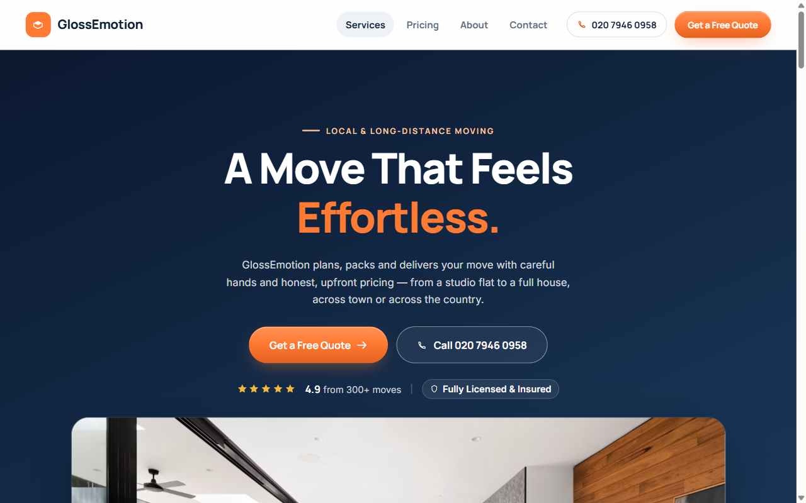

# GlossEmotion — Moving Company Website

Multi-page website for a local and long-distance moving company: services, pricing, about and contact pages with a quote form.

**Live demo:** [daryaulida.github.io/GlossEmotion/](https://daryaulida.github.io/GlossEmotion/)



## Features

- 4 pages: home, pricing, about, contact
- Quote request form and click-to-call
- Trust elements: ratings, licensing, reviews
- Responsive, lightweight vanilla JS

## Tech stack

HTML · CSS · JavaScript

## Run locally

No build step — clone the repository and open `index.html` in a browser.

```bash
git clone https://github.com/daryaulida/GlossEmotion.git
```

---

Made by [Daria Ulida](https://github.com/daryaulida) · [Otido](https://otido.dev) — websites, SEO and automation.
